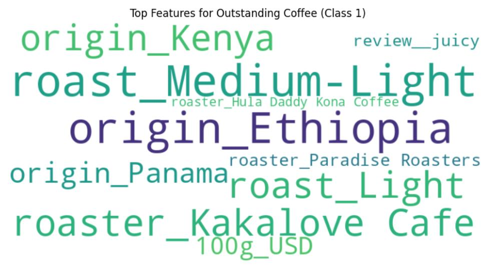
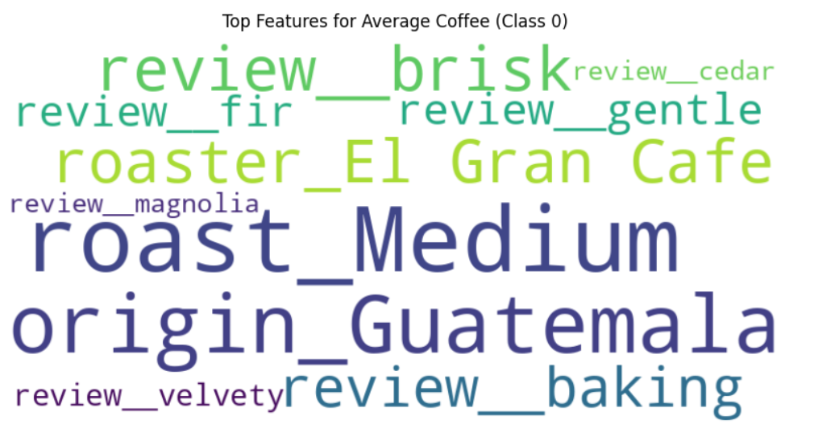
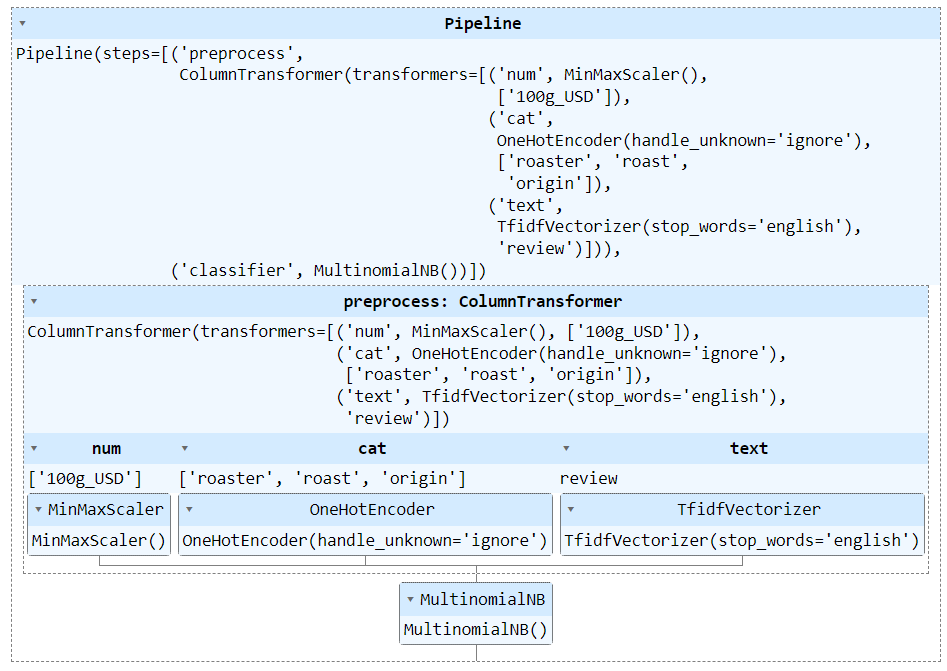

# Prediction of Coffee Ratings Based on Attributes and Identified Notes


A machine-learning project that predicts coffee quality — outstanding vs. average — from a coffee's attributes (roaster, roast level, origin, price) and its tasting notes. The model is a Multinomial Naive Bayes classifier in a scikit-learn pipeline, evaluated with 5-fold cross-validation using the F1 score.

## Key Results

- **Validation F1: 0.906** (training F1: 0.956) — full model on 620 training coffees, 5-fold cross-validation
- **Tasting notes carry almost all of the signal:** adding the review text lifts validation F1 from **0.829 → 0.906**
- **Price adds nothing further:** adding price per 100 g leaves validation F1 unchanged at 0.906
- **Top predictors of an outstanding coffee:** Medium-Light roast, Ethiopian origin, Kakalove Cafe, and the tasting note "juicy"

## Authors

- Jannatul Ferdaus
- **Areefin Ul Hassan Chowdhury**
- Martha Asare
- Samsunnahar Bipasha

April 2024. Jannatul and Areefin built the model and code; Martha and Samsunnahar wrote the report.

## Results

| Features used | Training F1 | Validation F1 |
|---|---|---|
| Categorical only (roaster, roast, origin) | 0.894 | 0.829 |
| + Tasting-note text (TF-IDF) | 0.956 | **0.906** |
| + Price per 100 g | 0.956 | 0.906 |
| All features | 0.956 | 0.906 |

The tasting notes carry almost all of the signal: adding the review text lifts validation F1 from 0.829 to 0.906, while price adds nothing further. The full model reaches a **validation F1 of 0.906**.

### What predicts an outstanding coffee

- **Roast:** Medium-Light and Light roasts
- **Origin:** Ethiopia, Kenya, Panama
- **Roasters:** Kakalove Cafe, Paradise Roasters, Hula Daddy Kona Coffee
- **Tasting note:** "juicy"

Average coffees lean toward Medium roast, Guatemalan origin, and notes like "brisk", "baking", and "velvety".


*Most influential features for outstanding coffee (class 1): Medium-Light roast, Ethiopian origin, Kakalove Cafe, and "juicy" tasting notes.*


*Most influential features for average coffee (class 0): Medium roast, Guatemalan origin, and notes like "brisk", "baking", and "velvety".*

## Method

A single scikit-learn `Pipeline` combines preprocessing and classification, so the same transformations apply to training and test data:

1. **Numerical** — `100g_USD` (price per 100 g) scaled with `MinMaxScaler`.
2. **Categorical** — `roaster`, `roast`, `origin` one-hot encoded with `OneHotEncoder` (`handle_unknown='ignore'`).
3. **Text** — tasting-note `review` vectorized with `TfidfVectorizer`.
4. **Classifier** — `MultinomialNB`, chosen for text/count-style features and its speed with categorical data.

All three feature types are joined with a `ColumnTransformer`. The model was trained on 620 coffees and evaluated with 5-fold cross-validation (`cross_val_score`, `cross_validate`).


*The full pipeline: price is scaled, categorical attributes are one-hot encoded, tasting notes are TF-IDF vectorized, and a Multinomial Naive Bayes classifier makes the prediction.*

## Data

| File | Contents |
|---|---|
| `data/X_train.csv` | 620 training coffees: `coffee_id`, `roaster`, `roast`, `origin`, `100g_USD`, `review` |
| `data/X_test.csv` | 267 test coffees, same columns |
| `data/format.csv` | Submission format: 267 rows, one `class` column |
| `data/result.csv` | Model predictions for the test set: 1 = outstanding, 0 = average |

The training labels (`y_train.csv`) are not in this repo yet and will be added when available.

## How to Run

```bash
pip install pandas numpy scikit-learn wordcloud
jupyter notebook DataMiningProject.ipynb
```

The notebook loads the CSVs from `data/` and reproduces the pipeline, cross-validation, feature-importance tables, and word clouds.

## Repository layout

```
├── DataMiningProject.ipynb          # Full analysis notebook (preprocessing, pipeline, CV, word clouds)
├── README.md
├── LICENSE
├── data/
│   ├── X_train.csv                  # Training features (620 rows)
│   ├── X_test.csv                   # Test features (267 rows)
│   ├── format.csv                   # Submission format
│   ├── result.csv                   # Model predictions for the test set
│   └── README.md                    # Data dictionary
├── images/
│   ├── pipeline.png                 # scikit-learn pipeline diagram
│   ├── wordcloud-outstanding.png    # Top features for outstanding coffee
│   └── wordcloud-average.png        # Top features for average coffee
├── report/
│   ├── Project_Report.pdf           # Full 9-page project report
│   ├── Project_Report.docx
│   └── Coffee_Rating_Writeup.pdf    # Condensed write-up
└── notebooks/
    └── DataMiningProject_Colab_Printout.pdf   # Printable Colab export of the notebook
```

## License

This project is licensed under the MIT License — see [LICENSE](LICENSE).
